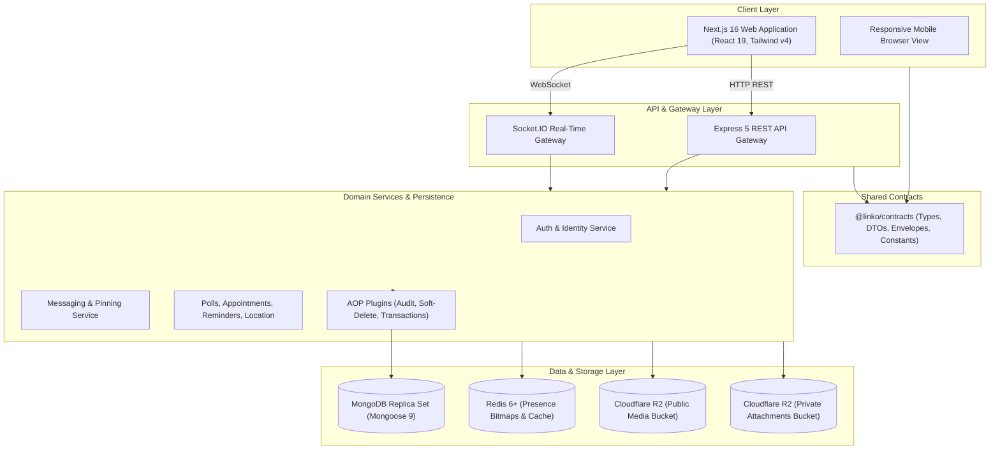

# Linko — Modern Real-Time Messaging & Collaboration Platform

[](https://www.typescriptlang.org/)
[](https://nextjs.org/)
[](https://expressjs.com/)
[](https://www.mongodb.com/)
[](https://redis.io/)
[](https://socket.io/)
[](https://tailwindcss.com/)

Linko is an enterprise-ready, full-stack real-time messaging application designed for seamless team
communication, 1-on-1 direct conversations, and rich interactive in-chat utilities (polls,
appointments, durable reminders, and live foreground location sharing).

---

## Table of Contents

- [Core Features](#core-features)
- [System Architecture](#system-architecture)
- [Monorepo Workspace Structure](#monorepo-workspace-structure)
- [Prerequisites & System Requirements](#prerequisites--system-requirements)
- [Quick Start Guide](#quick-start-guide)
- [Environment Configuration Matrix](#environment-configuration-matrix)
- [Monorepo CLI Commands Reference](#monorepo-cli-commands-reference)
- [Database Management & Migration Runbooks](#database-management--migration-runbooks)
- [Testing & Quality Verification](#testing--quality-verification)
- [Technical Documentation Hub](#technical-documentation-hub)
- [Engineering Standards & Best Practices](#engineering-standards--best-practices)

---

## Core Features

- **⚡ Real-Time Messaging & Presence:** Instant message delivery via Socket.IO, active typing
  indicators with debounced timeouts, and high-performance contact presence tracking backed by Redis
  bitfields with an in-memory fallback.
- **👥 Direct & Group Conversations:** Rich 1-on-1 direct messaging, public group invitations,
  shareable preview links, and multi-tier role-based access control (`OWNER`, `ADMIN`, `MEMBER`).
- **📊 Interactive Chat Utilities:**
  - **Polls:** Single-choice and multiple-choice voting with real-time tally bars and voter
    visibility.
  - **Appointments:** Schedule events with attendance RSVP (`Going`, `Maybe`, `Declined`) and
    timezone awareness.
  - **Durable Reminders:** Scheduled background reminder engine with distributed lease acquisition
    and unread synchronization.
  - **Foreground Live Location:** Real-time privacy-preserving GPS sharing powered by Leaflet maps
    with monotonic sequence enforcement.
- **📎 Dual-Bucket Storage (Cloudflare R2):** Public CDN bucket for cropped avatars and banners;
  isolated private bucket for message attachments with authenticated streaming verification.
- **🛡️ Enterprise Data Governance:**
  - Automated AOP audit columns (`createdBy`, `updatedBy`, `createdIp`, `updatedIp`) populated from
    request context via `AsyncLocalStorage`.
  - Transparent soft delete (`delFlag`) on all collections with partial unique indexes preventing
    username/email reuse collisions.
- **📦 Predictable API Envelopes:** All REST endpoints return uniform
  `{ success, data, error, meta }` envelopes, eliminating ad-hoc responses.

---

## System Architecture



---

## Monorepo Workspace Structure

Linko is managed as a **pnpm monorepo workspace**:

```
linko/
├── backend/                    # Express 5 backend API & Socket.IO server
│   ├── src/                    # Application source code
│   │   ├── modules/            # Feature modules (auth, message, utility, etc.)
│   │   ├── models/             # Mongoose schemas and indexes
│   │   ├── shared/             # Persistence aspects, errors, logger, middlewares
│   │   ├── app.ts              # Composition root wiring dependencies
│   │   └── index.ts            # Server entrypoint
│   └── scripts/                # Database management & migration scripts
│
├── frontend/                   # Next.js 16 (App Router) client application
│   ├── app/                    # Route layout tree & page components
│   ├── features/               # Domain feature modules (chat, inbox, utilities, etc.)
│   └── shared/                 # Shared UI components, HTTP client, theming, hooks
│
├── packages/
│   └── contracts/              # Shared TypeScript contracts, DTOs, envelopes & constants
│
└── docs/                       # Comprehensive technical architecture & guide documents
    ├── architecture/           # System design & real-time protocol specifications
    ├── api/                    # REST API endpoint contracts
    ├── database/               # MongoDB schema & migration runbooks
    ├── storage/                # Cloudflare R2 dual-bucket architecture
    ├── features/               # Chat utilities deep-dive (Polls, Appointments, etc.)
    └── guides/                 # Developer onboarding and environment setup
```

---

## Prerequisites & System Requirements

- **Node.js:** `>= 20.18.0` (LTS recommended)
- **pnpm:** `^11.15.1` (installed globally: `npm i -g pnpm`)
- **MongoDB:** `^7.0` (Local or MongoDB Atlas with Replica Set enabled for transactions)
- **Redis:** `^6.0` (Local or hosted instance; optional for basic local dev)
- **Cloudflare R2 Account:** S3-compatible credentials (optional for initial text-only dev)

---

## Quick Start Guide

### 1. Clone & Install Dependencies

```sh
# Clone repository
git clone https://github.com/your-username/linko.git
cd linko

# Install all workspace dependencies
pnpm install
```

### 2. Configure Environment Variables

```sh
# Copy example configuration for backend
cp backend/.env.example backend/.env

# Copy example configuration for frontend
cp frontend/.env.example frontend/.env.local
```

Edit `backend/.env` and update `MONGODB_CONNECTION_STRING` with your MongoDB URI.

### 3. Seed Development Database

```sh
# Seed demo accounts (An, Binh, Chi, Duong with password LinkoDemo123!)
pnpm run db:seed
```

### 4. Start Development Servers

```sh
# Starts both Backend (port 5000) and Frontend (port 3000) concurrently
pnpm dev
```

Visit [http://localhost:3000](http://localhost:3000) to open the Linko web app.

---

## Environment Configuration Matrix

### Backend (`backend/.env`)

| Variable                    | Required | Default / Example                 | Purpose                                                   |
| --------------------------- | -------- | --------------------------------- | --------------------------------------------------------- |
| `PORT`                      | No       | `5000`                            | HTTP port for Express server                              |
| `NODE_ENV`                  | No       | `development`                     | Runtime environment (`development`, `production`, `test`) |
| `CLIENT_URL`                | Yes      | `http://localhost:3000`           | Allowed CORS origin for frontend                          |
| `MONGODB_CONNECTION_STRING` | Yes      | `mongodb://localhost:27017/linko` | MongoDB connection URI                                    |
| `DNS_SERVERS`               | No       | `1.1.1.1,8.8.8.8`                 | Trusted DNS resolvers for MongoDB SRV lookups             |
| `REDIS_URL`                 | No       | `redis://localhost:6379`          | Redis connection for presence bitfields                   |
| `JWT_ACCESS_SECRET`         | Yes      | `(32+ characters secret)`         | Secret key signing access JWTs                            |
| `JWT_REFRESH_SECRET`        | Yes      | `(32+ characters secret)`         | Secret key signing refresh JWTs                           |
| `JWT_ACCESS_EXPIRES_IN`     | No       | `15m`                             | Lifetime of access tokens                                 |
| `JWT_REFRESH_EXPIRES_IN`    | No       | `7d`                              | Lifetime of refresh tokens                                |
| `R2_ACCOUNT_ID`             | Optional | `your_account_id`                 | Cloudflare account identifier                             |
| `R2_ACCESS_KEY_ID`          | Optional | `your_access_key`                 | S3-compatible access key                                  |
| `R2_SECRET_ACCESS_KEY`      | Optional | `your_secret_key`                 | S3-compatible secret key                                  |
| `R2_PUBLIC_BUCKET`          | Optional | `linko-public-media`              | Public media bucket name                                  |
| `R2_PRIVATE_BUCKET`         | Optional | `linko-private-attachments`       | Private attachments bucket name                           |
| `R2_PUBLIC_BASE_URL`        | Optional | `https://media.linko.test`        | Public CDN URL for images                                 |

### Frontend (`frontend/.env.local`)

| Variable                      | Required | Default / Example                                    | Purpose                                 |
| ----------------------------- | -------- | ---------------------------------------------------- | --------------------------------------- |
| `NEXT_PUBLIC_API_URL`         | Yes      | `http://localhost:5000`                              | Target backend URL for REST & Socket.IO |
| `NEXT_PUBLIC_MAP_TILE_URL`    | No       | `https://{s}.tile.openstreetmap.org/{z}/{x}/{y}.png` | Leaflet tile provider URL template      |
| `NEXT_PUBLIC_MAP_ATTRIBUTION` | No       | `&copy; OpenStreetMap contributors`                  | Leaflet map attribution string          |

---

## Monorepo CLI Commands Reference

Run all commands from the repository root:

| Command                     | Target   | Action                                                         |
| --------------------------- | -------- | -------------------------------------------------------------- |
| `pnpm dev`                  | Root     | Run both backend and frontend concurrently in development mode |
| `pnpm run be:dev`           | Backend  | Run backend with live file-watching (`tsx watch`)              |
| `pnpm run fe:dev`           | Frontend | Run Next.js with Turbopack development server                  |
| `pnpm build`                | All      | Typecheck backend and build Next.js production bundle          |
| `pnpm typecheck`            | All      | Run TypeScript type checks across all workspaces               |
| `pnpm lint`                 | All      | Run backend type checks and frontend ESLint                    |
| `pnpm test`                 | All      | Run all backend (Vitest) and frontend (Vitest) tests           |
| `pnpm run fe:lint:tailwind` | Frontend | Verify all Tailwind CSS class names are canonical              |

---

## Database Management & Migration Runbooks

Linko includes custom CLI scripts for database maintenance, collection checks, and safe migrations:

```sh
# 1. View connection status and collection document counts
pnpm run db:status

# 2. Open an interactive mongosh shell using configured connection string
pnpm run db:shell

# 3. Seed development accounts
pnpm run db:seed

# 4. Clear Linko-owned collections (guards against production databases)
pnpm run db:clear

# 5. Dry-run audit backfill migration
pnpm run db:migrate:audit

# 6. Apply audit backfill migration to documents
pnpm run db:migrate:audit -- --apply

# 7. Apply partial unique indexes for soft-deleted records
pnpm run db:migrate:audit -- --apply --apply-indexes --backup-confirmed --dry-run-reviewed

# 8. Dry-run notification preference transition
pnpm run db:migrate:notifications

# 9. Apply notification preference transition
pnpm run db:migrate:notifications -- --apply

# 10. Dry-run chat utility indexes
pnpm run db:migrate:chat-utilities
```

---

## Testing & Quality Verification

Linko maintains strict quality assurance across all layers:

- **Backend Unit & Integration Tests (Vitest):** Tests execute against isolated in-memory replica
  sets via `mongodb-memory-server`.
- **Frontend Unit & Component Tests (Vitest & Testing Library):** Verifies React hooks, form
  behaviors, rendering logic, and state synchronizations.
- **End-to-End Tests (Playwright):** Exercises real browser flows for registration, group creation,
  messaging, and chat utilities.

```sh
# Run backend test suite
pnpm run be:test

# Run frontend test suite
pnpm run fe:test

# Run entire test suite across all workspaces
pnpm test
```

---

## Technical Documentation Hub

For exhaustive technical guides, consult the dedicated documentation folder:

- 📖 [**Documentation Hub Index**](docs/README.md)
- 🏛️ [**System Architecture & Design**](docs/architecture/system-overview.md)
- ⚡ [**Real-Time Protocol & Socket.IO Events**](docs/architecture/realtime-protocol.md)
- 🔌 [**REST API Specification**](docs/api/rest-api-specification.md)
- 🗄️ [**Database Models, Indexes & Migrations**](docs/database/schema-and-migrations.md)
- ☁️ [**Cloudflare R2 Dual-Bucket Storage**](docs/storage/cloudflare-r2-dual-bucket.md)
- 🎯
  [**Chat Utilities Deep-Dive (Polls, Appointments, Reminders, Location)**](docs/features/chat-utilities-deep-dive.md)
- 🚀 [**Local Development & Onboarding Guide**](docs/guides/local-development-setup.md)

---

## Engineering Standards & Best Practices

All contributions must adhere to the core standards defined in [`AGENTS.md`](AGENTS.md):

- **SOLID Principles:** Single Responsibility, Open/Closed through strategies, Interface
  Segregation, Dependency Inversion with constructor injection.
- **AOP Everywhere:** Logging, authentication, validation, audit columns, and soft-delete filtering
  are implemented as aspects, never mixed into business code.
- **Immutability by Default:** Strict TypeScript (`strict: true`), readonly interfaces, no non-null
  assertions without justification.
- **Conventional Commits:** Clean, atomic Conventional Commits (`feat(...)`, `fix(...)`,
  `refactor(...)`, `docs(...)`, `style(...)`, `chore(...)`).
- **Immediate Commit Discipline:** Verified work is committed immediately.
