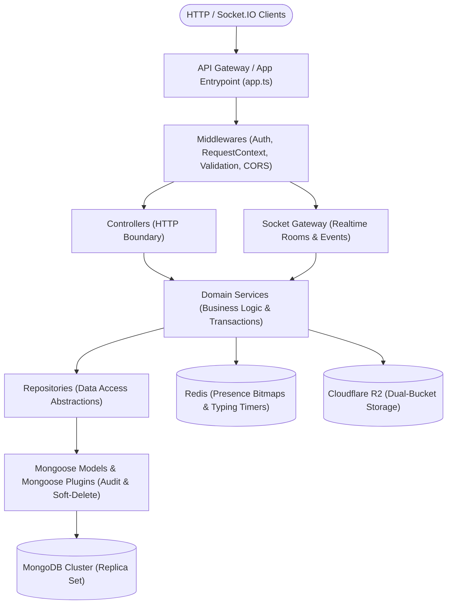

# Linko Backend Service (`linko-backend`)

> Enterprise-grade, clean-architecture real-time messaging server built with **Express 5**, **Node.js (ES Modules)**, **Mongoose 9 / MongoDB**, **Redis 6+**, **Socket.IO 4**, and **Cloudflare R2**.

---

## Table of Contents

- [Architectural Overview](#architectural-overview)
- [Layered Architecture (Clean Code & SOLID)](#layered-architecture-clean-code--solid)
- [Aspect-Oriented Programming (AOP)](#aspect-oriented-programming-aop)
- [Real-Time Communications Engine](#real-time-communications-engine)
- [Cloudflare R2 Dual-Bucket Storage](#cloudflare-r2-dual-bucket-storage)
- [Chat Utilities Engine](#chat-utilities-engine)
- [Complete REST API Specification](#complete-rest-api-specification)
- [Socket.IO Events Specification](#socketio-events-specification)
- [Environment Configuration](#environment-configuration)
- [Database Management & Migration Runbook](#database-management--migration-runbook)
- [Development & Testing Runbook](#development--testing-runbook)
- [Troubleshooting](#troubleshooting)

---

## Architectural Overview

Linko Backend follows strict layered architecture and Dependency Inversion. Business rules and orchestration reside exclusively inside services, isolated from transport protocols (HTTP/WebSocket) and data persistence engines (Mongoose/MongoDB).



---

## Layered Architecture (Clean Code & SOLID)

Every backend feature is organized into dedicated domain modules (`src/modules/*`):

| Layer | Responsibility | Constraints |
|---|---|---|
| **Routes** (`*.route.ts`) | Map HTTP verbs and paths to middleware chains and controller handlers. | **MUST NOT** contain application logic. |
| **Middlewares** (`*.middleware.ts`) | Cross-cutting request processing (JWT authentication, role authorization, Zod schema validation). | Never leak unhandled exceptions. |
| **Controllers** (`*.controller.ts`) | Extract validated parameters from `req`, delegate to **one** service method, wrap outputs in `ApiResponse.ok(...)`. | **MUST NOT** interact directly with database repositories. |
| **Services** (`*.service.ts`) | Pure business rules, domain invariants, authorization checks, and transaction boundaries (`withTransaction`). | Independent of Express `req`/`res` objects. |
| **Repositories** (`*.repository.ts`) | Encapsulate Mongoose queries, aggregations, and MongoDB writes behind typed interfaces. | No HTTP or transport concerns. |
| **Mappers / DTOs** (`*.mapper.ts`, `*.dto.ts`) | Transform internal Mongoose documents to client-safe DTOs, stripping sensitive credentials, internal object keys, and audit metadata. | DB documents never escape directly to the API boundary. |

---

## Aspect-Oriented Programming (AOP)

Cross-cutting system concerns are applied declaratively rather than manually repetitive inside business logic:

1. **Audit Aspect ([`auditPlugin.ts`](src/shared/persistence/auditPlugin.ts)):**
   - Automatically populates `createdBy`, `updatedBy`, `createdIp`, and `updatedIp` on every write.
   - Extracts current actor ID and remote IP from `AsyncLocalStorage` request context ([`requestContext.ts`](src/shared/middlewares/requestContext.ts)).
   - System workers and offline jobs default to `SYSTEM_ACTOR_ID` (`000000000000000000000001`).

2. **Soft-Delete Aspect ([`softDeletePlugin.ts`](src/shared/persistence/softDeletePlugin.ts)):**
   - Injects `delFlag: Boolean` (indexed).
   - Automatically appends `{ delFlag: { $ne: true } }` to all `find`, `findOne`, `countDocuments`, and `aggregate` pipelines.
   - Reading deleted documents requires an explicit query option (`{ includeDeleted: true }`).
   - Intercepts and rejects direct hard deletions (`deleteOne`, `deleteMany`, `findOneAndDelete`).

3. **Global Error Boundary ([`globalErrorHandler.ts`](src/shared/middlewares/globalErrorHandler.ts)):**
   - Maps `BusinessException` instances directly to clean, structured client responses (`4xx`).
   - Maps Zod validation errors to `400 VALIDATION`.
   - Maps JWT signature and expiration errors to `401 INVALID_TOKEN`.
   - Logs unexpected technical defects (`500 INTERNAL`) with stack traces and request correlation IDs while presenting a sanitized message to clients.

---

## Real-Time Communications Engine

Linko uses Socket.IO with an optimized real-time state engine:

- **Room Partitioning:** Clients automatically join their authorized user room (`user:<userId>`) and conversation rooms (`conv:<conversationId>`).
- **Presence Engine via Redis Bitmap:**
  - High-performance tracking using Redis bitfields (`SETBIT` / `GETBIT`) mapped by user offset.
  - Automatic fallback to in-memory presence tracking if Redis is unreachable or unconfigured.
- **Typing Cadence & Throttling:**
  - Debounced emission schedule (refresh interval: 1000ms, idle timeout: 2500ms, receiver expiry: 3500ms).
  - Emits transient `typing:started` and `typing:stopped` events without persisting state in MongoDB.
- **Utility Invalidation:**
  - Emits `utility:changed` events carrying only `{ conversationId, kind, resourceId, revision }`.
  - Clients invalidate TanStack Query caches and refetch through authorized REST endpoints. Private coordinates and sensitive payloads are never broadcast over WebSocket rooms.

---

## Cloudflare R2 Dual-Bucket Storage

Media storage uses Cloudflare R2 (S3-compatible API) segmented into two distinct isolation zones:

```
Cloudflare R2
├── Public Media Bucket (R2_PUBLIC_BUCKET)
│   ├── User Profile Avatars (max 800px JPEG)
│   ├── Profile Background Images
│   └── Group Avatars
│   └── Served globally via Custom CDN Domain (R2_PUBLIC_BASE_URL)
│
└── Private Attachments Bucket (R2_PRIVATE_BUCKET)
    ├── Documents (PDF, DOCX, XLSX, PPTX, TXT, CSV)
    ├── Compressed Media & Image Files (up to 10 MiB)
    └── Zero Public Domain Access (Private, Non-resolvable)
        └── Streamed exclusively through /api/messages/:messageId/attachments/:attachmentId
            └── Re-checks active conversation membership and permissions on every chunk.
```

- **MIME Sniffing & Verification:** File headers are verified using `file-type` magic bytes. Mismatched extensions or forged MIME types are rejected before upload.
- **Object Key Privacy:** Internal R2 object keys (`storageKey`) are kept strictly confidential inside the database and never leaked in API DTOs.

---

## Chat Utilities Engine

Interactive chat utilities enhance team collaboration directly inside message streams:

1. **Interactive Polls:**
   - Single-choice and multiple-choice voting modes.
   - Atomically prevents double-voting via unique compound indexes and array filters.
   - Supports explicit vote revocation and creator/admin deadline closures.
2. **Scheduled Appointments:**
   - Optimistic concurrency control via monotonic `revision` numbers.
   - Individual attendee RSVP states (`going`, `maybe`, `declined`).
   - Configurable personal reminder triggers (0, 5, 15, or 60 minutes prior to start).
3. **Durable Reminders:**
   - Background worker processes scheduled reminder jobs using distributed lease acquisition.
   - Safe delivery with deduplication and unread counter synchronization.
4. **Foreground Live Location Sharing:**
   - Real-time location broadcast with strict monotonic sequence numbers.
   - Enforces minimum 5-second throttling between updates.
   - Auto-expires after duration (15m, 1h, 8h) or immediate manual stop.
   - Stored coordinates are stripped immediately upon session closure for maximum privacy.

---

## Complete REST API Specification

All responses are wrapped in the standard `{ success, data, error, meta }` envelope.

### Authentication & Account (`/api/auth`)

| Method | Endpoint | Auth | Description | Payload / Notes |
|---|---|---|---|---|
| `POST` | `/api/auth/signup` | No | Register a new user account | `{ username, password, email, displayName }` |
| `POST` | `/api/auth/login` | No | Authenticate user credentials | `{ username, password }` -> Sets HttpOnly refresh cookie |
| `POST` | `/api/auth/refresh-token` | Cookie | Rotate refresh session & issue access token | Reads HttpOnly refresh cookie |
| `POST` | `/api/auth/logout` | Optional | Invalidate current session and clear cookie | Clears refresh cookie |

### Users & Profiles (`/api/users`)

| Method | Endpoint | Auth | Description | Payload / Notes |
|---|---|---|---|---|
| `GET` | `/api/users/me` | Bearer | Get authenticated user profile | Returns `UserProfileDto` |
| `PATCH` | `/api/users/me` | Bearer | Update bio, display name, avatar, background | Multipart form-data (`avatar`, `background`, `bio`, etc.) |
| `GET` | `/api/users/:userId` | Bearer | Get public profile of another user | Returns `UserProfileDto` |
| `GET` | `/api/users` | Bearer | Search users by username or name | Query: `?q=query&limit=20` |

### Friends & Connections (`/api/friends`)

| Method | Endpoint | Auth | Description | Payload / Notes |
|---|---|---|---|---|
| `GET` | `/api/friends` | Bearer | List accepted friends | Returns list of friend summaries |
| `GET` | `/api/friends/requests` | Bearer | List incoming & outgoing pending requests | Returns pending friend requests |
| `POST` | `/api/friends/requests` | Bearer | Send a new friend request | `{ recipientId }` |
| `POST` | `/api/friends/requests/:id/accept` | Bearer | Accept a pending friend request | Creates reciprocal friendship |
| `POST` | `/api/friends/requests/:id/decline` | Bearer | Decline a pending friend request | Updates request status |
| `DELETE` | `/api/friends/:friendId` | Bearer | Unfriend a user | Soft-deletes friendship |

### Conversations & Inbox (`/api/conversations`)

| Method | Endpoint | Auth | Description | Payload / Notes |
|---|---|---|---|---|
| `GET` | `/api/conversations` | Bearer | List conversations in user's inbox | Query: `?kind=all\|group\|direct` |
| `POST` | `/api/conversations/groups` | Bearer | Create a new group conversation | Multipart: `name`, `description`, `avatar`, `members` |
| `GET` | `/api/conversations/:id` | Bearer | Get conversation details and metadata | Requires active membership |
| `PATCH` | `/api/conversations/:id` | Bearer | Update group name, description, avatar | Admin or Owner role required |
| `POST` | `/api/conversations/:id/leave` | Bearer | Leave a group conversation | Revokes active membership |
| `POST` | `/api/conversations/:id/close` | Bearer | Close/archive group conversation | Owner role required |

### Group Memberships & Roles (`/api/conversations/:id/participants`)

| Method | Endpoint | Auth | Description | Payload / Notes |
|---|---|---|---|---|
| `GET` | `/api/conversations/:id/participants` | Bearer | List group members | Returns list of `MemberDto` |
| `PATCH` | `/api/conversations/:id/participants/:userId` | Bearer | Change participant role (`ADMIN` / `MEMBER`) | Owner/Admin required |
| `POST` | `/api/conversations/:id/transfer-owner` | Bearer | Transfer ownership of the group | Owner role required; `{ newOwnerId }` |

### Group Invitations (`/api/invitations`)

| Method | Endpoint | Auth | Description | Payload / Notes |
|---|---|---|---|---|
| `POST` | `/api/conversations/:id/invitations` | Bearer | Issue a shareable invitation link | Returns invitation token and expiration |
| `GET` | `/api/invitations/:token` | Optional | Preview group details via invite token | Public minimal preview |
| `POST` | `/api/invitations/:token/join` | Bearer | Accept invitation and join group | Requires authentication |

### Messages & Attachments (`/api/messages`)

| Method | Endpoint | Auth | Description | Payload / Notes |
|---|---|---|---|---|
| `GET` | `/api/messages` | Bearer | Fetch message history with cursor pagination | Query: `?conversationId=...&cursor=...&limit=30` |
| `POST` | `/api/messages` | Bearer | Send text message with attachments | Multipart: `conversationId`, `content`, `attachments`, etc. |
| `GET` | `/api/messages/:messageId/attachments/:attachmentId` | Bearer | Securely stream private file attachment | Membership verification per download |

### Pins & Read State

| Method | Endpoint | Auth | Description | Payload / Notes |
|---|---|---|---|---|
| `GET` | `/api/conversations/:id/pins` | Bearer | List pinned messages in conversation | Max 3 pins per conversation |
| `POST` | `/api/conversations/:id/pins/:messageId` | Bearer | Pin a message | Admin or Owner role required |
| `DELETE` | `/api/conversations/:id/pins/:messageId` | Bearer | Unpin a message | Admin or Owner role required |
| `POST` | `/api/conversations/:id/read` | Bearer | Mark conversation messages as read | `{ lastReadMessageId }` |

### Chat Utilities (`/api/conversations/:id/...`)

| Method | Endpoint | Auth | Description | Payload / Notes |
|---|---|---|---|---|
| `POST` | `.../polls` | Bearer | Create a new interactive poll | `{ question, options, mode, closesAt }` |
| `GET` | `.../polls/:resourceId` | Bearer | Get poll details and tally | Returns `PollDto` |
| `POST` | `.../polls/:resourceId/vote` | Bearer | Submit or update poll vote | `{ optionIds }` |
| `POST` | `.../polls/:resourceId/close` | Bearer | Close poll voting | Poll creator or group admin |
| `POST` | `.../appointments` | Bearer | Schedule an appointment | `{ title, description, startsAt, endsAt, place }` |
| `GET` | `.../appointments/:resourceId` | Bearer | Get appointment details & RSVPs | Returns `AppointmentDto` |
| `PATCH` | `.../appointments/:resourceId` | Bearer | Update appointment details | Optimistic concurrency via `{ revision }` |
| `POST` | `.../appointments/:resourceId/rsvp` | Bearer | Submit personal RSVP and reminder | `{ status: 'going'\|'maybe'\|'declined', reminderMinutes }` |
| `POST` | `.../appointments/:resourceId/cancel` | Bearer | Cancel scheduled appointment | Creator or admin |
| `POST` | `.../locations` | Bearer | Start live location sharing session | `{ durationMinutes, publisherId, latitude, longitude, accuracy }` |
| `POST` | `.../locations/:resourceId/fix` | Bearer | Push updated GPS coordinate fix | Monotonic sequence check, throttled to 5s |
| `POST` | `.../locations/:resourceId/stop` | Bearer | Stop sharing live location | Strips all stored coordinates |
| `GET` | `.../locations/:resourceId` | Bearer | Get current active location fix | Returns `LocationShareDto` |
| `POST` | `/api/reminders` | Bearer | Create a standalone message reminder | `{ conversationId, messageId, dueAt, note }` |
| `GET` | `/api/reminders/inbox` | Bearer | Fetch personal reminder notifications | Paginated list with unread counter |
| `POST` | `/api/reminders/read-all` | Bearer | Mark all delivered reminders as read | Batch update |

---

## Socket.IO Events Specification

### Client to Server (Emitters)

| Event | Payload | Description |
|---|---|---|
| `typing:start` | `{ conversationId }` | Notify conversation participants that user started typing |
| `typing:stop` | `{ conversationId }` | Notify conversation participants that user stopped typing |
| `presence:query` | `{ userIds: string[] }` | Query current online/offline status for up to 200 users |

### Server to Client (Listeners)

| Event | Payload | Description |
|---|---|---|
| `message:new` | `MessageDto` | New message published to conversation room |
| `typing:started` | `{ conversationId, userId }` | Participant started typing |
| `typing:stopped` | `{ conversationId, userId }` | Participant stopped typing |
| `presence:changed` | `{ userId, status: 'online'\|'offline' }` | Contact presence state transition |
| `utility:changed` | `{ conversationId, kind, resourceId, revision }` | Utility updated (triggers cache invalidation) |
| `reminder:delivered` | `ReminderDto` | Reminder triggered and delivered to private user room |

---

## Environment Configuration

Configure `backend/.env` based on [`backend/.env.example`](.env.example):

```env
# Server Runtime
PORT=5000
NODE_ENV=development
CLIENT_URL=http://localhost:3000

# MongoDB Configuration
MONGODB_CONNECTION_STRING=mongodb://localhost:27017/linko
DNS_SERVERS=1.1.1.1,8.8.8.8 # Optional custom DNS resolver for mongodb+srv connections

# Redis (Presence & Realtime Cache)
REDIS_URL=redis://localhost:6379

# JWT Secrets & Session Expiry
JWT_ACCESS_SECRET=your_jwt_access_secret_key_minimum_32_chars
JWT_REFRESH_SECRET=your_jwt_refresh_secret_key_minimum_32_chars
JWT_ACCESS_EXPIRES_IN=15m
JWT_REFRESH_EXPIRES_IN=7d

# Cloudflare R2 Storage
R2_ACCOUNT_ID=your_cloudflare_account_id
R2_ACCESS_KEY_ID=your_r2_access_key_id
R2_SECRET_ACCESS_KEY=your_r2_secret_access_key
R2_PUBLIC_BUCKET=linko-public-media
R2_PRIVATE_BUCKET=linko-private-attachments
R2_PUBLIC_BASE_URL=https://media.linko.test
```

---

## Database Management & Migration Runbook

All database migration commands are dry-run by default. Review counts before applying writes.

```sh
# Inspect database connection and document counts
pnpm run db:status

# Interactive mongo shell session
pnpm run db:shell

# Seed development database with demo accounts (An, Binh, Chi, Duong)
pnpm run db:seed

# Clear Linko collections (refuses production mode; prompts for DB confirmation)
pnpm run db:clear

# Preview audit fields backfill
pnpm run db:migrate:audit

# Apply audit fields backfill to MongoDB
pnpm run db:migrate:audit -- --apply

# Apply audit indexes and rebuild partial unique indexes
pnpm run db:migrate:audit -- --apply --apply-indexes --backup-confirmed --dry-run-reviewed

# Preview notification preference migration
pnpm run db:migrate:notifications

# Apply notification preference migration
pnpm run db:migrate:notifications -- --apply

# Preview chat utility indexes
pnpm run db:migrate:chat-utilities
```

---

## Development & Testing Runbook

```sh
# Start backend in development mode with live reload
pnpm run be:dev

# Run all backend unit & integration tests (uses MongoMemoryServer)
pnpm run be:test

# Run TypeScript compiler check
pnpm run be:typecheck

# Run backend linter
pnpm run be:lint
```

---

## Troubleshooting

- **MongoDB SRV DNS Refusal (`querySrv ECONNREFUSED`):**
  If Node fails to resolve MongoDB Atlas SRV records, specify trusted public resolvers in `backend/.env`:
  ```env
  DNS_SERVERS=1.1.1.1,8.8.8.8
  ```
- **Redis Connection Errors:**
  If Redis is unavailable locally, Linko gracefully downgrades presence tracking to in-memory mode for development.
- **R2 Storage Errors:**
  Ensure the R2 API token has `Object Read & Write` permissions for both public and private buckets.
