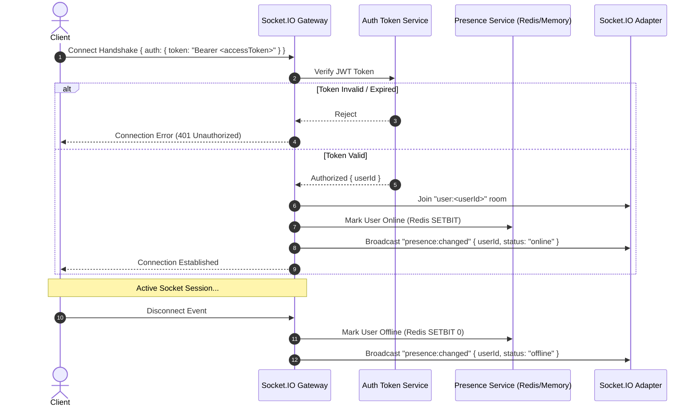

# Real-Time Protocol & Socket.IO Engine Specification

This document details the real-time communications engine in Linko, including Socket.IO transport lifecycle, room partitioning, typing indicator throttling, presence tracking via Redis bitmaps, and utility event invalidations.

---

## 1. Connection & Handshake Lifecycle

Clients initiate a persistent WebSocket connection to the Socket.IO gateway:



---

## 2. Room Topology & Message Routing

Socket.IO rooms segment traffic so users receive only messages intended for their authorized scope:

| Room Name | Scope | Membership Criteria | Events Delivered |
|---|---|---|---|
| `user:<userId>` | Private User Room | Explicitly joined by authenticated user socket upon connection. | Private notifications, friend requests, delivered reminders. |
| `conv:<conversationId>` | Conversation Room | Joined by active participants of a direct or group chat. | New chat messages, typing events, utility invalidation events. |

---

## 3. Real-Time Events Catalog

All socket events and payloads are defined in `@linko/contracts`:

### 3.1 Client-to-Server Emitters

#### `typing:start`
- **Payload:** `{ conversationId: string }`
- **Description:** Signals that the authenticated user has begun typing in the specified conversation.
- **Throttling:** Client throttles updates to a minimum interval of 1000ms.

#### `typing:stop`
- **Payload:** `{ conversationId: string }`
- **Description:** Signals that the user has stopped typing or cleared the composer draft.

#### `presence:query`
- **Payload:** `{ userIds: string[] }`
- **Description:** Batch queries online/offline status for up to 200 users.
- **Response:** Client receives individual `presence:changed` events or a direct callback mapping.

---

### 3.2 Server-to-Client Listeners

#### `message:new`
- **Room:** `conv:<conversationId>`
- **Payload:** `MessageDto`
- **Description:** Broadcast to all active conversation participants when a new message is successfully committed to the database.

#### `typing:started`
- **Room:** `conv:<conversationId>` (excluding sender socket)
- **Payload:** `{ conversationId: string, userId: string }`
- **Description:** Informs participants that a peer is currently typing.

#### `typing:stopped`
- **Room:** `conv:<conversationId>` (excluding sender socket)
- **Payload:** `{ conversationId: string, userId: string }`
- **Description:** Informs participants that a peer has stopped typing.

#### `presence:changed`
- **Room:** Broadcast to contacts / relevant user rooms
- **Payload:** `{ userId: string, status: "online" | "offline" }`
- **Description:** Emitted when a contact transitions between connected and disconnected states.

#### `utility:changed`
- **Room:** `conv:<conversationId>`
- **Payload:**
  ```ts
  interface UtilityChangedEvent {
    conversationId: string
    kind: "poll" | "appointment" | "location" | "pin" | "reminder"
    resourceId: string
    revision: number
  }
  ```
- **Description:** Invalidation event notifying clients that a utility state has advanced to a new revision. Clients invalidate TanStack Query caches to refetch through authorized REST endpoints. **Raw coordinates or confidential survey answers are never transmitted over socket broadcasts.**

#### `reminder:delivered`
- **Room:** `user:<userId>`
- **Payload:** `ReminderDto`
- **Description:** Delivered to the private user room when a scheduled reminder job reaches its due time.

---

## 4. Presence Tracking Engine (Redis Bitmaps)

To minimize memory footprint and handle high-concurrency presence tracking, Linko utilizes **Redis Bitmaps**:

1. **User Index Mapping:**
   - User ObjectIds are deterministically hashed or mapped to sequential integer offsets.
2. **Online Status Mutation:**
   - Setting online: `SETBIT presence:active <offset> 1`
   - Setting offline: `SETBIT presence:active <offset> 0`
3. **Querying Status:**
   - Single check: `GETBIT presence:active <offset>`
   - Batch check: Uses a pipeline or Redis Lua script to inspect multiple bit offsets in a single round-trip.
4. **Fault-Tolerant Memory Fallback:**
   - If Redis connection is absent or drops, the presence system automatically falls back to an in-memory `Set<string>` without crashing the server.

---

## 5. Typing Indicator Cadence & Timing Constants

Defined in [`realtime.ts`](../../packages/contracts/src/realtime.ts):

| Constant | Value | Description |
|---|---|---|
| `TYPING_TIMING.REFRESH_MS` | `1000ms` | Minimum interval before sending a renewed `typing:start` pulse while actively keystroking. |
| `TYPING_TIMING.IDLE_MS` | `2500ms` | Period of inactivity before the composer automatically sends `typing:stop`. |
| `TYPING_TIMING.EXPIRY_MS` | `3500ms` | Receiver-side fallback timeout to remove typing bubble if no `typing:stop` is received. |
