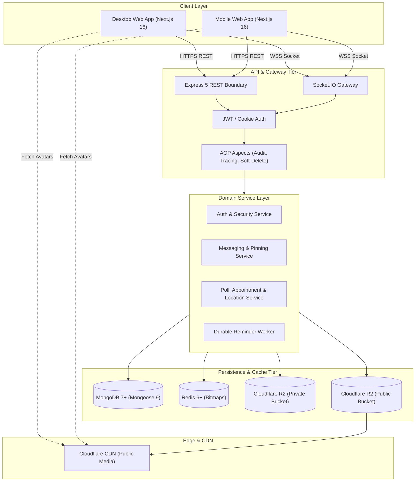
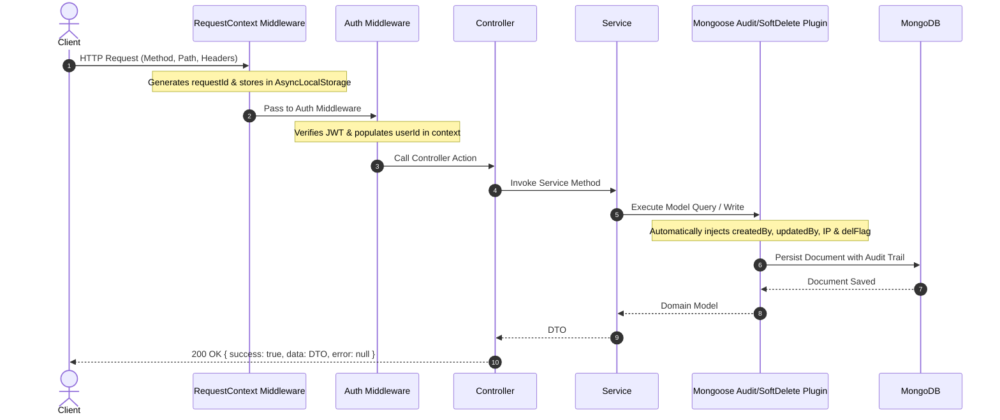

# Linko System Architecture & Design Overview

This document describes the architectural design, component topology, design patterns, and cross-cutting aspects of the Linko messaging platform.

---

## 1. High-Level System Architecture

Linko is architected as a distributed real-time communication platform split into three decoupled tiers:

1. **Client Tier (Frontend):** Next.js 16 (App Router), React 19, Tailwind CSS v4, TanStack Query, and Socket.IO Client.
2. **API & Real-Time Tier (Backend):** Express 5 REST API gateway and Socket.IO real-time server running on Node.js with TypeScript.
3. **Data & Storage Tier:** MongoDB (Replica Set with Mongoose ORM), Redis (Presence bitfields & caching), and Cloudflare R2 (S3-compatible dual-bucket object storage).



---

## 2. Monorepo Organization & Workspace Boundaries

Linko uses a **pnpm monorepo** with three workspaces:

```
linko/
├── packages/contracts/         # Shared API types, DTOs, constants, envelopes
├── backend/                    # Express 5, Socket.IO, Mongoose, Redis
└── frontend/                   # Next.js 16 App Router, React 19, Tailwind v4
```

### Dependency Rules:
- **`@linko/contracts`** has **zero runtime dependencies** and imports no code from backend or frontend.
- **`backend`** depends on `@linko/contracts`.
- **`frontend`** depends on `@linko/contracts`.
- Neither `backend` nor `frontend` may ever directly import code from the other application workspace.

---

## 3. Backend Layered Architecture (Clean Code & SOLID)

Dependencies point strictly inward:

```
Route -> Middleware -> Controller -> Service -> Repository -> Mongoose Model -> MongoDB
                             |            |
                            DTOs     Domain Logic / Events
```

### Architectural Responsibilities:

| Layer | Responsibility | What it MUST NOT do |
|---|---|---|
| **Route** (`*.route.ts`) | Maps HTTP paths and verbs to middlewares and controllers. | Contain logic or database calls. |
| **Middleware** (`*.middleware.ts`) | Request validation, authentication checks, request context derivation. | Catch business errors to suppress them. |
| **Controller** (`*.controller.ts`) | Extracts validated request inputs, executes one service method, envelopes the output (`ApiResponse.ok`). | Execute business rules or call repositories. |
| **Service** (`*.service.ts`) | Implements domain business logic, invariants, permission checks, transaction boundaries (`withTransaction`). | Inspect Express `req`/`res` objects or return HTTP statuses. |
| **Repository** (`*.repository.ts`) | Abstracts Mongoose queries, database aggregations, and atomic updates. | Contain business authorization checks. |
| **Mapper** (`*.mapper.ts`) | Maps database models to clean, client-safe DTOs, stripping secrets and internal fields. | Be skipped when returning data to the client. |

---

## 4. Aspect-Oriented Programming (AOP)

Cross-cutting concerns are separated from business logic into declarative aspects:



### Core Aspects:
1. **Request Tracing:** Every HTTP request receives a unique `requestId` stored in Node.js `AsyncLocalStorage` ([`requestContext.ts`](../../backend/src/shared/middlewares/requestContext.ts)).
2. **Audit Tracking:** [`auditPlugin.ts`](../../backend/src/shared/persistence/auditPlugin.ts) automatically sets `createdBy`, `updatedBy`, `createdIp`, and `updatedIp` on all creates and updates.
3. **Soft-Delete Filtering:** [`softDeletePlugin.ts`](../../backend/src/shared/persistence/softDeletePlugin.ts) enforces `delFlag: false` by default on all queries.
4. **Error Translation:** [`globalErrorHandler.ts`](../../backend/src/shared/middlewares/globalErrorHandler.ts) catches all unhandled exceptions at the top of the stack and transforms them into standardized `ApiFailure` envelopes.

---

## 5. Security Architecture

1. **Authentication:**
   - **Access Token:** Short-lived JWT (15 minutes) sent via `Authorization: Bearer <token>` header.
   - **Refresh Token:** Long-lived JWT (7 days) stored exclusively in an `HttpOnly`, `Secure`, `SameSite=Lax` cookie. Persisted as a cryptographic hash in MongoDB to prevent session leakage.
   - **Token Rotation:** Each refresh request invalidates the old session and issues a fresh refresh token.
2. **Authorization & RBAC:**
   - Conversation membership is verified at both the route boundary (middleware) and service layer (ownership checks).
   - Roles (`OWNER`, `ADMIN`, `MEMBER`) govern group administration, message pinning, member role elevation, and group closures.
3. **Storage Security:**
   - Message attachments are stored in a non-public R2 bucket with no public CDN.
   - Every file download stream checks active conversation membership and permissions before sending chunks.
