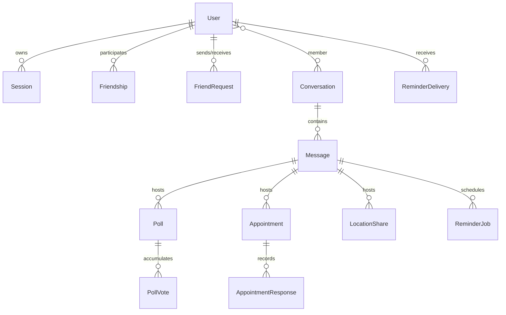

# Database Models, Indexes & Migration Runbooks

This document provides complete documentation for the MongoDB database architecture used by Linko, including Mongoose schemas, relationships, partial unique indexes, AOP audit fields, soft delete mechanics, and production migration runbooks.

---

## 1. Collections & Data Models Overview

Linko manages 13 collections across authentication, relationships, messaging, and chat utilities:



---

## 2. Mandatory Audit Columns & Soft Delete

Every persisted collection in Linko includes the following standard fields injected via Mongoose plugins:

| Column | Mongoose Type | Indexed? | Description | Set By |
|---|---|---|---|---|
| `createdAt` | `Date` (UTC) | Yes | Creation timestamp | Mongoose `{ timestamps: true }` |
| `updatedAt` | `Date` (UTC) | No | Last update timestamp | Mongoose `{ timestamps: true }` |
| `createdBy` | `ObjectId` (ref: User) | No | User ID who initiated creation | `auditPlugin` (from `AsyncLocalStorage`) |
| `updatedBy` | `ObjectId` (ref: User) | No | User ID who initiated last mutation | `auditPlugin` (from `AsyncLocalStorage`) |
| `createdIp` | `String` (max 45) | No | Client IP during creation | `auditPlugin` |
| `updatedIp` | `String` (max 45) | No | Client IP during last mutation | `auditPlugin` |
| `delFlag` | `Boolean` | Yes | Soft-delete flag (default `false`) | `softDeletePlugin` |

### System Fallback Actor
When mutations originate from background processes or CLI migration scripts outside an HTTP request context, `createdBy` and `updatedBy` default to the reserved `SYSTEM_ACTOR_ID`:
```ts
export const SYSTEM_ACTOR_ID = new mongoose.Types.ObjectId("000000000000000000000001")
```

---

## 3. Schema Definitions & Indexes

### 3.1 `users` Collection
Stores registered user accounts, authentication hashes, and profile metadata.

- **Key Fields:** `username`, `email`, `password` (bcrypt hash), `displayName`, `bio`, `avatarUrl`, `backgroundUrl`.
- **Partial Unique Indexes:**
  - `{ username: 1 }` where `{ delFlag: false }`
  - `{ email: 1 }` where `{ delFlag: false }`

### 3.2 `sessions` Collection
Stores active refresh token sessions for JWT rotation.

- **Key Fields:** `userId`, `tokenHash` (SHA-256 hash of refresh token), `expiresAt`.
- **Indexes:**
  - `{ userId: 1, delFlag: 1 }`
  - `{ tokenHash: 1 }` where `{ delFlag: false }`
  - `{ expiresAt: 1 }` (TTL or expiry check)

### 3.3 `conversations` Collection
Represents both 1-on-1 direct messaging and multi-user group conversations.

- **Key Fields:**
  - `type`: `"DIRECT" | "GROUP"`
  - `status`: `"ACTIVE" | "CLOSED"`
  - `group`: `{ name, description, avatarUrl, ownerId, invitationToken, isPublic }`
  - `participants`: Array of `{ userId, role: "OWNER"|"ADMIN"|"MEMBER", isMuted, mutedUntil, joinedAt }`
  - `lastMessage`: `{ messageId, senderId, content, createdAt }`
- **Indexes:**
  - `{ "participants.userId": 1, delFlag: 1 }`
  - `{ "group.invitationToken": 1 }` where `{ "group.invitationToken": { $type: "string" }, delFlag: false }`
  - Direct chat pair index: `{ "participants.userId": 1, type: 1 }`

### 3.4 `messages` Collection
Stores chat timeline items, reply hierarchies, mentions, attachments, and utility links.

- **Key Fields:** `conversationId`, `senderId`, `clientMessageId`, `content`, `kind`, `resourceId`, `replyTo`, `mentions`, `attachments`.
- **Attachments Schema:** Array of `{ _id, storageKey, url, name, contentType, size }`.
- **Indexes:**
  - Cursor pagination index: `{ conversationId: 1, _id: -1, delFlag: 1 }`
  - Idempotency index: `{ conversationId: 1, clientMessageId: 1 }` where `{ delFlag: false }`

### 3.5 `friendships` & `friendrequests` Collections
- **Friendships:** Symmetrical friend pairs `{ user1Id, user2Id, status: "accepted" }`.
  - Partial unique index: `{ user1Id: 1, user2Id: 1 }` where `{ delFlag: false }`.
- **FriendRequests:** Pending invitations `{ requesterId, recipientId, status: "pending"|"accepted"|"declined" }`.
  - Partial unique index: `{ requesterId: 1, recipientId: 1 }` where `{ status: "pending", delFlag: false }`.

### 3.6 Chat Utilities Collections
- **`polls` & `pollvotes`:** Poll definitions and user votes.
  - Vote deduplication: Compound index `{ pollId: 1, userId: 1 }` where `{ delFlag: false }`.
- **`appointments` & `appointmentresponses`:** Event schedules and attendee RSVPs.
  - Concurrency index: `{ _id: 1, revision: 1 }`.
  - Attendance index: `{ appointmentId: 1, userId: 1 }`.
- **`locationshares`:** Active GPS sessions. Stored fixes are purged when session is terminated.
- **`reminderjobs` & `reminderdeliveries`:** Scheduled reminders and user inbox delivery entries.
  - Polling index: `{ status: 1, dueAt: 1, claimedUntil: 1 }`.

---

## 4. Migration Runbooks

All migration scripts are executed via the root pnpm CLI and are **dry-run by default**.

### 4.1 Audit Field Backfill & Partial Unique Indexes

Script: [`backend/scripts/backfillAudit.ts`](../../backend/scripts/backfillAudit.ts)

1. **Step 1: Backup Database**
   Verify a restorable MongoDB snapshot before running index or document updates.
2. **Step 2: Dry Run**
   ```sh
   pnpm run db:migrate:audit
   ```
   Inspect counts of legacy documents missing `createdBy`, `updatedBy`, `createdIp`, `updatedIp`, or `delFlag`.
3. **Step 3: Apply Document Backfill**
   ```sh
   pnpm run db:migrate:audit -- --apply
   ```
   Rerun without `--apply`; every count must report zero.
4. **Step 4: Apply Partial Unique Indexes**
   ```sh
   pnpm run db:migrate:audit -- --apply --apply-indexes --backup-confirmed --dry-run-reviewed
   ```
   Replaces legacy uniqueness indexes with partial indexes scoped to `{ delFlag: false }`.

---

### 4.2 Group Notification Preferences Transition

Script: [`backend/scripts/migrateNotificationPreferences.ts`](../../backend/scripts/migrateNotificationPreferences.ts)

Transitions legacy `mutedUntil` timestamps to explicit `isMuted: Boolean` flags:

1. **Step 1: Dry Run**
   ```sh
   pnpm run db:migrate:notifications
   ```
2. **Step 2: Apply Migration**
   ```sh
   pnpm run db:migrate:notifications -- --apply
   ```

---

### 4.3 Chat Utilities Indexes

Script: [`backend/scripts/migrateChatUtilities.ts`](../../backend/scripts/migrateChatUtilities.ts)

Ensures indexes for Polls, Appointments, Reminders, and Location sessions are created:

1. **Step 1: Dry Run**
   ```sh
   pnpm run db:migrate:chat-utilities
   ```
2. **Step 2: Apply Indexes**
   ```sh
   pnpm run db:migrate:chat-utilities -- --apply
   ```
