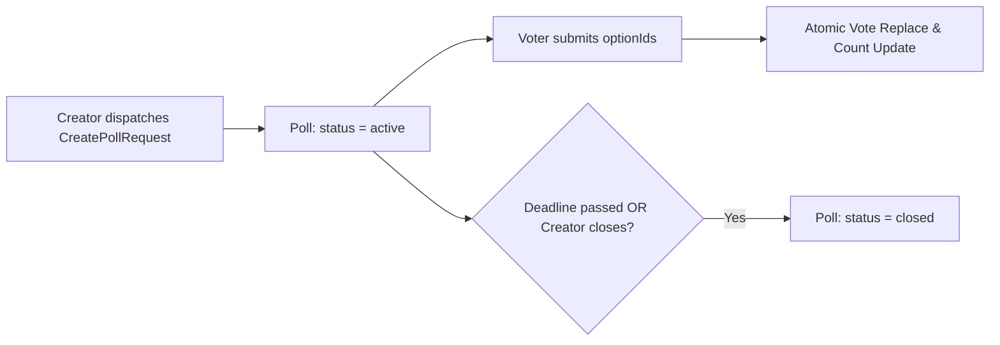
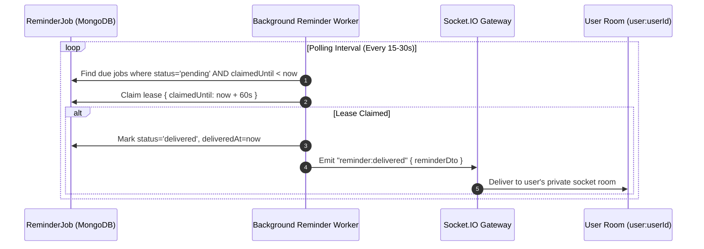
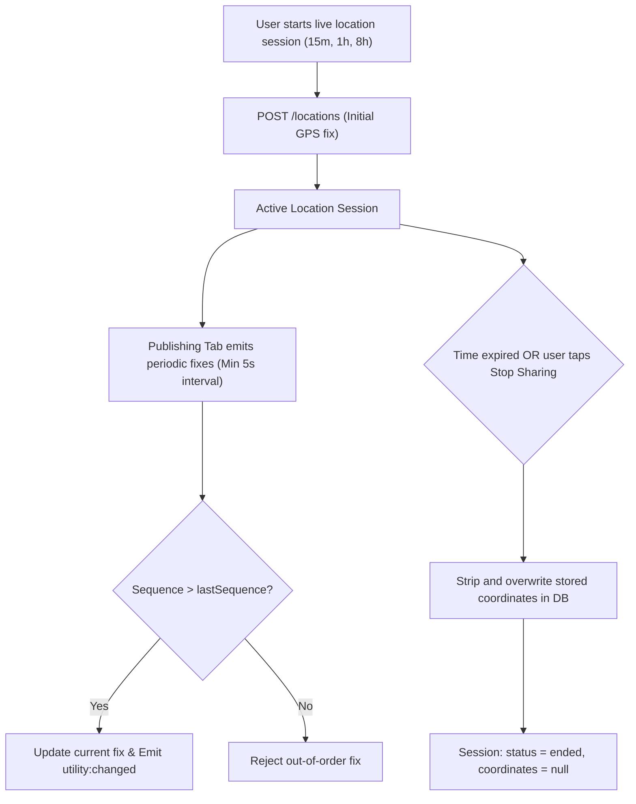

# Chat Utilities Deep-Dive

Linko provides a suite of interactive, first-class utilities embedded directly inside chat streams:

1. **Interactive Polls**
2. **Scheduled Appointments**
3. **Durable Reminders**
4. **Foreground Live Location Sharing**

This document details their operational mechanics, concurrency models, data flows, and security constraints.

---

## 1. Concurrency Model & Invalidation Protocol

All chat utilities share a common base DTO (`ChatUtilityDto`) featuring an optimistic concurrency `revision` counter:

```ts
export interface ChatUtilityDto {
  readonly id: string
  readonly conversationId: string
  readonly messageId: string
  readonly creatorId: string
  readonly createdAt: string
  readonly revision: number
}
```

### Invalidation Pattern:
- When a utility is mutated (a vote is cast, an appointment is edited, or an RSVP changes), the backend increments `revision`.
- Instead of broadcasting user responses or private data over WebSocket rooms, the server emits a lightweight `utility:changed` invalidation:
  ```json
  {
    "conversationId": "651d4567...",
    "kind": "poll",
    "resourceId": "651d9999...",
    "revision": 4
  }
  ```
- Clients invalidate their local TanStack Query cache key for that utility and refetch the full, viewer-authorized representation via authenticated REST endpoints.

---

## 2. Interactive Polls



### Operational Rules:
- **Modes:** Single-choice (`single`) or multiple-choice (`multiple`).
- **Options Limits:** Between 2 and 10 options per poll; each option string limited to 120 characters.
- **Vote Atomicity:** Handled via atomic MongoDB updates. If a user votes again, their previous selection is updated without creating duplicate vote documents.
- **Closing Permissions:** Only the poll creator or group administrators (`ADMIN` / `OWNER`) may explicitly close a poll.

---

## 3. Scheduled Appointments & RSVPs

Appointments allow groups and direct contacts to coordinate calendar events directly inside conversations.

### Data Flow:
1. **Creation:** Creator submits title, start time, optional end time, timezone, and location string.
2. **Optimistic Updates:** Edits require supplying the existing `revision` number. If another admin updated the appointment concurrently, a `409 Conflict` is returned.
3. **RSVP Choices:** Attendees submit their attendance state (`going`, `maybe`, `declined`).
4. **Automatic Reminder Linking:** When an attendee marks `going`, they can specify an optional reminder offset (0, 5, 15, or 60 minutes prior to event start). The backend schedules a corresponding `ReminderJob`.

---

## 4. Durable Reminder Queue & Worker

Linko runs a resilient background worker for reminders:



### Key Guarantees:
- **At-Least-Once Delivery:** Uses distributed lease locking (`claimedUntil`). If a worker crashes mid-delivery, the lease expires and another worker safely picks up the job.
- **Pre-Join Visibility Guard:** If a reminder originated from a group chat before a user joined, or if the source message was deleted, delivery is safely suppressed.

---

## 5. Foreground Live Location Sharing

Live GPS tracking is designed for real-time meetups while enforcing strict user privacy:



### Privacy & Accuracy Safeguards:
1. **Monotonic Sequences:** Each fix emitted by the publisher includes an incrementing sequence number. Out-of-order or stale browser GPS fixes are rejected.
2. **Throttling Enforcement:** Updates must be spaced at least 5000ms apart. Rapid spam is rejected with a rate limit error.
3. **Zero Breadcrumb Trails:** Linko stores only the **single latest GPS coordinate**. Historical route breadcrumbs are never recorded.
4. **Immediate Coordinate Purging:** The instant a location session expires or is manually stopped, all stored latitude and longitude values are permanently erased (`null`) from the database.
5. **Leaflet Client-Only Rendering:** Map tiles load dynamically using Leaflet only after an explicit click, avoiding telemetry tracking or tile prefetching.
