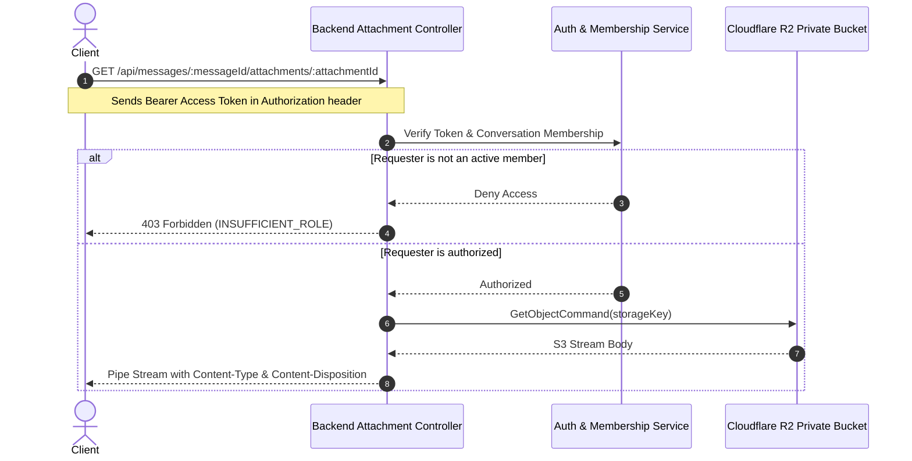

# Cloudflare R2 Dual-Bucket Storage Architecture

This document details the storage architecture in Linko, focusing on Cloudflare R2 integration, dual-bucket security isolation, file validation, and secure attachment streaming.

---

## 1. Storage Topology & Isolation Model

Linko isolates user media and private message attachments into two distinct Cloudflare R2 buckets:

```
Cloudflare R2 Storage
├── 1. Public Media Bucket (R2_PUBLIC_BUCKET)
│   ├── User Avatars
│   ├── User Profile Banners
│   ├── Group Conversation Avatars
│   └── Access Model: Public Read via Custom Domain CDN (R2_PUBLIC_BASE_URL)
│
└── 2. Private Attachments Bucket (R2_PRIVATE_BUCKET)
    ├── PDF Documents
    ├── Office Spreadsheets & Slides (DOCX, XLSX, PPTX)
    ├── Plaintext & Data Files (TXT, CSV)
    ├── Message Photo & Audio Attachments
    └── Access Model: Zero Public Access (No public URL, no CDN)
        └── Streamed exclusively through Linko Backend API
```

---

## 2. Public Media Bucket

- **Intended Data:** Public-facing imagery, including user avatars, group icons, and profile banners.
- **Image Processing (`sharp`):**
  - Incoming uploads are resized to a maximum width of 800 pixels.
  - Converted and compressed into progressive JPEG format.
  - Strips all camera metadata (EXIF/GPS) for user privacy.
- **CDN Distribution:**
  - Files are served directly via Cloudflare's global edge network at `R2_PUBLIC_BASE_URL`.
  - Edge caching offloads heavy media traffic from the Node.js backend.

---

## 3. Private Attachments Bucket & Secure Streaming

To protect sensitive shared documents and user files, message attachments are stored in an unexposed bucket with strict access boundaries:



### Security Guarantees:
1. **Confidential Object Keys:** The internal S3 storage key (e.g., `private/attachments/2026/11/abc-123.bin`) is never returned to the client or embedded in public markup.
2. **Per-Request Authorization:** Every download re-evaluates user conversation membership in real time. If a user leaves or is kicked from a group, they immediately lose access to all attachments in that group.
3. **No Direct URLs:** The private bucket has public access permanently disabled in the Cloudflare dashboard.

---

## 4. File Validation & MIME Sniffing

All uploaded files are subjected to multi-stage validation before being persisted:

1. **Size Constraints:** Limited to a maximum of `10 MiB` per file.
2. **Signature Verification (`file-type`):**
   - Inspects binary magic numbers to determine true MIME type.
   - Prevents file spoofing (e.g., uploading an executable disguised as a `.pdf` or `.png`).
3. **Accepted File Formats:**
   - **Images:** `image/jpeg`, `image/png`, `image/webp`
   - **Documents:** `application/pdf`, `application/vnd.openxmlformats-officedocument.*` (DOCX, XLSX, PPTX)
   - **Text & Data:** `text/plain` (UTF-8 verified), `text/csv` (UTF-8 verified)

---

## 5. Environment Configuration

```env
# Cloudflare R2 Credentials
R2_ACCOUNT_ID=your_cloudflare_account_id
R2_ACCESS_KEY_ID=your_s3_compatible_access_key
R2_SECRET_ACCESS_KEY=your_s3_compatible_secret_key

# Bucket Identifiers
R2_PUBLIC_BUCKET=linko-public-media
R2_PRIVATE_BUCKET=linko-private-attachments

# Public CDN Host
R2_PUBLIC_BASE_URL=https://media.linko.test
```
