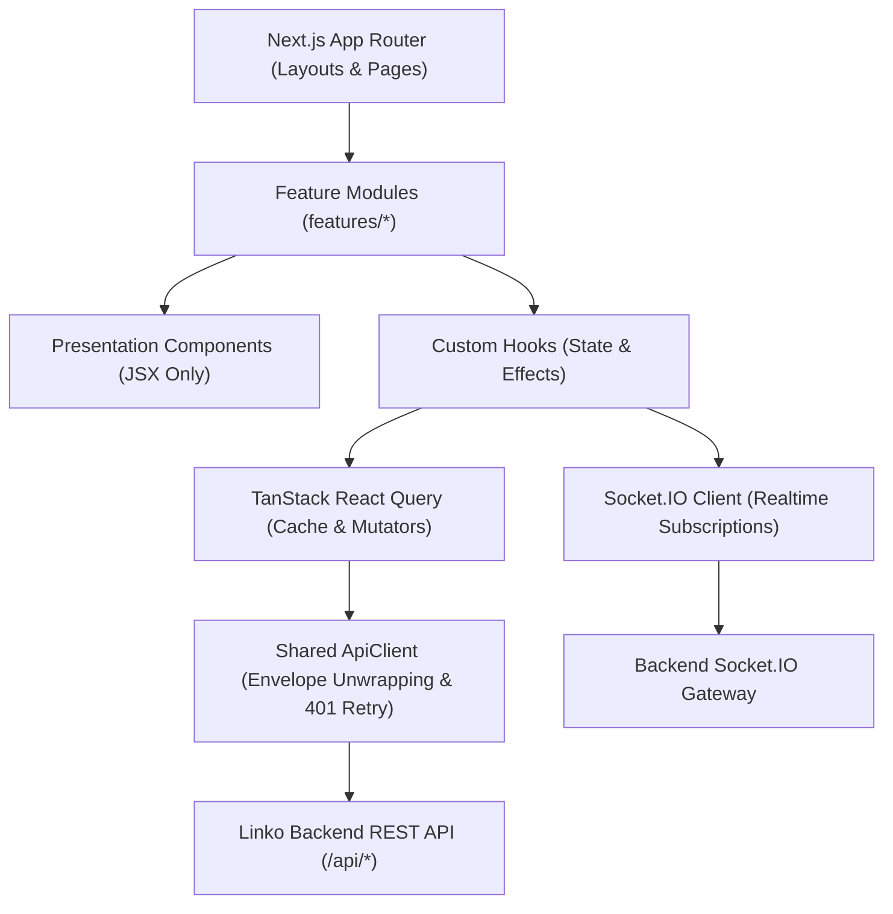

# Linko Frontend Application (`linko-frontend`)

> High-performance, modern real-time messaging client built with **Next.js 16 (App Router & Turbopack)**, **React 19**, **Tailwind CSS v4**, **TanStack Query v5**, **Socket.IO Client**, and **Leaflet 1.9**.

---

## Table of Contents

- [Architectural Overview](#architectural-overview)
- [Feature-Driven Folder Structure](#feature-driven-folder-structure)
- [Separation of Concerns: UI vs. Logic](#separation-of-concerns-ui-vs-logic)
- [Real-Time State & Socket Integration](#real-time-state--socket-integration)
- [Interactive Chat Utilities](#interactive-chat-utilities)
- [Live Location & Leaflet Maps](#live-location--leaflet-maps)
- [Design System & Theming](#design-system--theming)
- [Environment Configuration](#environment-configuration)
- [Development, Linting & Build](#development-linting--build)
- [Testing Strategy](#testing-strategy)

---

## Architectural Overview

Linko Frontend utilizes Next.js App Router with Server-Rendered structural layouts and responsive client features. Network requests, session lifecycles, and real-time socket events are coordinated through custom React hooks and TanStack Query caches, guaranteeing reactive UI updates without page reloads.



---

## Feature-Driven Folder Structure

Code is strictly organized by business domain features rather than arbitrary technical folders:

```
frontend/
├── app/                        # Next.js App Router routes
│   ├── (app)/                  # Authenticated workspace layout and sub-routes
│   │   ├── inbox/              # Main messaging workspace
│   │   ├── direct/[conversationId]/ # 1-on-1 private chat
│   │   ├── groups/[conversationId]/ # Group chat & settings
│   │   ├── people/             # Friend discovery & requests
│   │   ├── profile/            # User profile view/edit
│   │   ├── settings/           # Notification & preference controls
│   │   └── notifications/      # Real-time notification center
│   ├── login/                  # Authentication login page
│   ├── signup/                 # New user registration page
│   └── invite/[token]/         # Public group invitation landing page
│
├── features/                   # Domain features
│   ├── auth/                   # Session handling, login/signup forms, auth API
│   ├── chat/                   # Message bubbles, timeline, composer, pins, mentions
│   ├── utilities/              # Polls, Appointments, Reminders, Foreground Location
│   ├── groups/                 # Group creation wizard, member management, invitations
│   ├── inbox/                  # Inbox conversation list, search, filter
│   ├── people/                 # Friend search, reciprocal requests, status cards
│   ├── profile/                # Profile editing, avatar cropping, banner uploads
│   └── settings/               # Sound preferences, mute controls, theme toggle
│
└── shared/                     # Reusable foundations
    ├── components/             # Atomic design components (Button, Modal, Input, Avatar)
    ├── http/                   # ApiClient, ApiError, envelope normalization
    ├── icons/                  # Scalable SVG icons and constants
    ├── layout/                 # Main sidebar, navigation drawer, breadcrumbs
    ├── presence/               # Real-time presence indicator hooks
    ├── realtime/               # Global Socket.IO context and connection lifecycle
    ├── theme/                  # Dark / Light mode provider & system preference listener
    └── i18n/                   # Multi-language translation support
```

---

## Separation of Concerns: UI vs. Logic

In compliance with the project's engineering standards:

1. **Component Files (`*.tsx`):**
   - Contain JSX and presentation logic only.
   - Zero direct `fetch` or HTTP calls.
   - Zero inline state orchestration or side effects.
2. **Custom Hook Files (`use*.ts`):**
   - Encapsulate all state hooks (`useState`, `useReducer`), effects (`useEffect`), URL search parameters (`useSearchParams`), and TanStack queries.
   - Return cleanly typed state values and action handlers to the presentation layer.

**Example Pattern:**

```tsx
// ✅ Presentation Component (ChatView.tsx)
export function ChatView({ conversationId }: { conversationId: string }) {
  const { messages, isTyping, handleSendMessage, isLoading } = useConversationChat(conversationId)

  if (isLoading) return <ChatSkeleton />

  return (
    <div className="flex flex-col h-full">
      <MessageList messages={messages} />
      {isTyping && <TypingIndicator />}
      <MessageComposer onSend={handleSendMessage} />
    </div>
  )
}
```

---

## Real-Time State & Socket Integration

Real-time capabilities are orchestrated through specialized hooks:

- **`useConversationChat`:** Subscribes to conversation rooms, handles cursor pagination for chat history, optimistic message rendering, and delivery status updates.
- **`usePresence`:** Tracks contact online/offline status using Socket.IO presence broadcasts and batch queries.
- **`useTypingIndicator` & `useTypingEmitter`:** Coordinates typing events with debounced timeouts (1s refresh, 2.5s idle threshold).
- **`useRealtimeNotifications`:** Listens for incoming group invitations, friend requests, reminders, and timeline activity cards. Displays in-app notification toasts and plays gentle audio notifications.

---

## Interactive Chat Utilities

The chat timeline supports rich interactive utilities implemented as embedded message cards:

- **Poll Cards (`PollMessageCard`):** Displays questions, vote tally bars, voter avatars, and real-time choice selection buttons.
- **Appointment Cards (`AppointmentMessageCard`):** Displays event scheduling details, RSVP status selectors (`Going`, `Maybe`, `Declined`), and timezone conversion.
- **Live Location Cards (`LocationMessageCard`):** Displays interactive map views of actively shared coordinates, accuracy rings, and session expiration countdowns.
- **Reminder Cards (`ReminderMessageCard`):** Direct navigation back to the source message context and one-click dismissal.

---

## Live Location & Leaflet Maps

Live GPS sharing is powered by client-only **Leaflet 1.9.4**:

- **On-Demand Loading:** Map tiles and Leaflet CSS are loaded dynamically only when an active map container is rendered, avoiding unnecessary bundle weight on initial load.
- **OpenStreetMap Standard:** Default tile layers comply with the OpenStreetMap tile usage policy with visible attribution.
- **Privacy-First Coordinates:** Exact coordinates are never stored in browser localStorage or URL query parameters. Stored fixes are cleared immediately when the sharing session ends.

---

## Design System & Theming

- Built with modern **Tailwind CSS v4** utility classes and custom theme tokens.
- **Light & Dark Theme:** Supports explicit manual theme switching and automatic system preference detection (`prefers-color-scheme`).
- **Typography:** Uses Be Vietnam Pro font (`@fontsource/be-vietnam-pro`) for clear readability across all devices.
- **Responsive Layout:** Responsive sidebar collapsing from wide desktop multi-column view down to mobile drawer navigation.

---

## Environment Configuration

Configure `frontend/.env.local` based on [`frontend/.env.example`](.env.example):

```env
# Backend API Base URL
NEXT_PUBLIC_API_URL=http://localhost:5000

# Optional Custom Map Tile Provider (Defaults to OpenStreetMap)
NEXT_PUBLIC_MAP_TILE_URL=https://{s}.tile.openstreetmap.org/{z}/{x}/{y}.png
NEXT_PUBLIC_MAP_ATTRIBUTION=&copy; OpenStreetMap contributors
```

---

## Development, Linting & Build

```sh
# Start Next.js development server (runs on http://localhost:3000)
pnpm run fe:dev

# Run Next.js production build with Turbopack
pnpm run fe:build

# Serve production build locally
pnpm run fe:start

# Run ESLint validation
pnpm run fe:lint

# Run Tailwind CSS class canonicalization linter
pnpm run fe:lint:tailwind

# Run TypeScript typecheck
pnpm run fe:typecheck
```

---

## Testing Strategy

- **Unit & Component Testing:** Powered by **Vitest** and **React Testing Library** in JSDOM environment (`pnpm run fe:test`).
- **End-to-End Testing:** Automated browser flows with **Playwright** covering authentication, group creation, messaging, and chat utilities.
